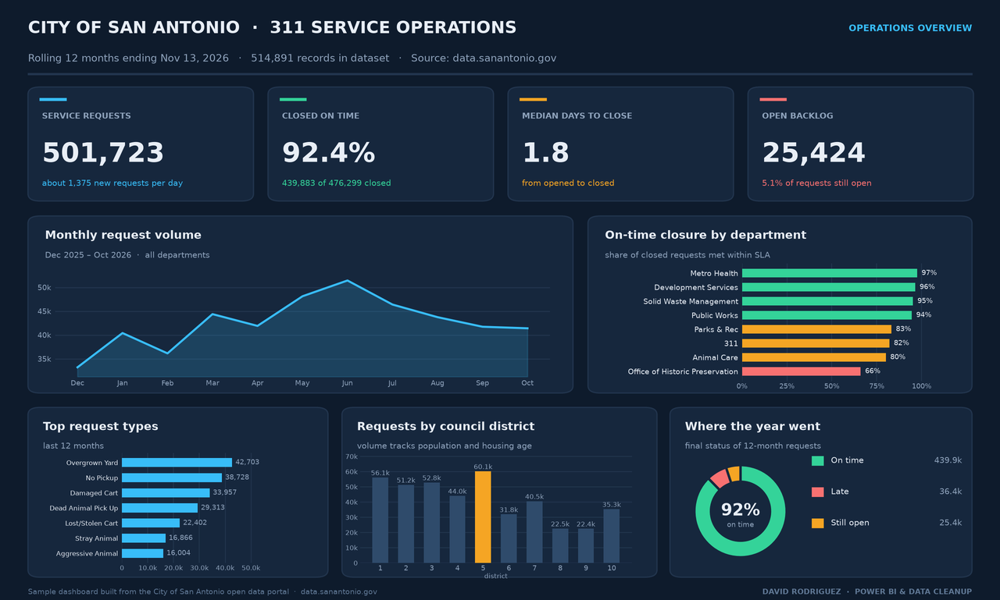

# San Antonio 311 — Service Operations Dashboard

A one-page operations dashboard built from the **real, public City of San Antonio 311 service-call dataset**. It answers four questions a city operations lead actually asks: how much work came in, how much was closed on time, how long it took, and what is still open.



Built by **David Rodriguez** — Power BI, data cleanup, and reporting automation.

---

## Headline numbers

Rolling 12 months, opened **Nov 14, 2025 → Nov 13, 2026**.

| Metric | Value | How it is calculated |
|---|---|---|
| Service requests received | **501,723** | Rows with an `OPENEDDATETIME` inside the window (≈1,375/day) |
| Closed on time | **92.4%** | `Late (Yes/No) = NO` ÷ all closed requests with an SLA verdict (439,883 of 476,299) |
| Median days to close | **1.8** | Median of `CLOSEDDATETIME − OPENEDDATETIME` for closed requests (0–400 day sanity filter) |
| Open backlog | **25,424** | `CASESTATUS = OPEN`, i.e. 5.1% of the year's requests |

**On-time closure by department** (share of closed requests meeting their SLA):

| Department | On time |
|---|---|
| Metro Health | 97.5% |
| Development Services | 96.4% |
| Solid Waste Management | 95.2% |
| Public Works | 94.5% |
| Parks & Recreation | 83.2% |
| 311 Call Center | 82.0% |
| Animal Care Services | 80.0% |
| Historic Preservation | 66.0% |

**Volume by council district:** District 5 is the busiest at **60.1k** requests for the year, followed by Districts 2 and 3. Volume broadly tracks population and housing age rather than any single service failure.

---

## Data source

Everything on this page comes from one public dataset. Nothing is simulated, sampled, or estimated.

| | |
|---|---|
| **Dataset** | 311 Service Calls |
| **Publisher** | City of San Antonio — 311 City Services (`311-city-services`) |
| **Portal** | https://data.sanantonio.gov |
| **Dataset page** | https://data.sanantonio.gov/dataset/93b0e7ee-3a55-4aa9-b27b-d1817e91aec3 |
| **CKAN package id** | `service-calls` |
| **Metadata API** | https://data.sanantonio.gov/api/3/action/package_show?id=service-calls |
| **File used** | `ALL SERVICE CALLS` (CSV) |
| **Resource id** | `20eb6d22-7eac-425a-85c1-fdb365fd3cd7` |
| **Direct download** | https://data.sanantonio.gov/dataset/93b0e7ee-3a55-4aa9-b27b-d1817e91aec3/resource/20eb6d22-7eac-425a-85c1-fdb365fd3cd7/download/allservicecalls.csv |
| **Data dictionary** | https://data.sanantonio.gov/dataset/93b0e7ee-3a55-4aa9-b27b-d1817e91aec3/resource/0eab0cfc-a114-4064-9f25-d088d8ac46a3/download/datadictionary-311.xlsx |
| **License** | Creative Commons Attribution (CC BY) — attribution required, reuse permitted |
| **Dataset last modified** | 2026-11-15 |
| **Data pulled on** | 2026-11-18 |
| **Records in file** | 514,891 |
| **Contact** | 311CustomerService@sanantonio.gov |

Fields used: `OPENEDDATETIME`, `CLOSEDDATETIME`, `SLA_Date`, `Late (Yes/No)`, `Dept`, `TYPENAME`, `CASESTATUS`, `COUNCIL_DIST`.

Full citation detail, field notes, and the exact API calls live in [`docs/DATA_SOURCES.md`](docs/DATA_SOURCES.md).

---

## Methodology

- **Window.** A rolling 12 months ending on the newest business date in the file, computed from the data rather than hard-coded (currently Nov 13, 2026). The file always covers exactly the past 365 days of the last upload, so a rolling year is the only honest window.
- **"On time"** is the city's own `Late (Yes/No)` verdict — `NO` means the case was closed within its SLA. Requests with a blank verdict (still open, cancelled, no SLA assigned) are excluded from the percentage rather than counted as failures.
- **Median, not mean.** Close time has a long right tail (some cases sit open for years). The median is what a resident actually experiences; the mean would be dragged upward by a handful of stale records.
- **Partial months are dropped from the trend line.** Because the window starts mid-month, the first and last buckets are incomplete. Plotting them produces a fake dip at both ends, so the trend chart shows Dec 2025 – Oct 2026.
- **No year-over-year comparison.** The published file contains only the last 365 days, so there is no prior-year baseline. Any YoY delta on this dashboard would be invented.

## Limitations

- This is an independent analysis of open data, **not** official city reporting. Figures are reproducible from the file above but may be revised by the city on the next refresh.
- The dataset is a rolling snapshot: rerunning later will produce different totals, by design.
- Council-district and department labels are the city's raw values; some are internal system names (`Health_Sanitation`) and were mapped to readable labels for display only.

---

## Reproduce it

Requires Python 3.10+ and `curl` (installed by default on macOS, Windows 10+, and most Linux systems). The download script uses curl because the city's file server blocks Python's built-in HTTP client.

```bash
git clone <your-repo-url>
cd san-antonio-311-dashboard
pip install -r requirements.txt

# 1. download the current CSV (~172 MB) into data/
python scripts/download_data.py

# 2. render the dashboard to output/
python build_dashboard.py
```

Outputs:

- `output/san_antonio_311_dashboard.png` — 1280 × 769, the image above (Fiverr image 1)
- `output/metrics.json` — every figure on the page, machine-readable, so the numbers in this README can be checked against a render

Useful flags:

```bash
python build_dashboard.py --csv /path/to/allservicecalls.csv --out /tmp/charts
```

---

## Repository layout

```
.
├── README.md
├── LICENSE
├── requirements.txt
├── build_dashboard.py            # renders the dashboard from the CSV
├── scripts/
│   └── download_data.py          # pulls the current CSV via the CKAN API
├── docs/
│   ├── DATA_SOURCES.md           # full citation, field notes, API calls
│   ├── FINDINGS.md               # longer write-up of what the numbers mean
│   └── san_antonio_311_dashboard.png
└── data/
    └── README.md                 # the CSV is gitignored; download it with the script
```

The raw CSV is **not** committed — it is ~172 MB and is refreshed daily by the city. `scripts/download_data.py` fetches the current copy and records its metadata.

---

## License

Code: MIT (see [LICENSE](LICENSE)).
Data: CC BY, City of San Antonio. Attribution: *City of San Antonio, 311 Service Calls, data.sanantonio.gov.*
